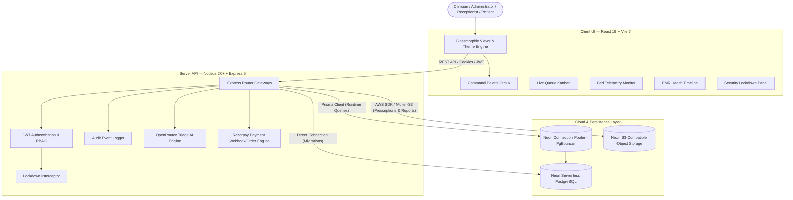

# 🏥 OrvantaHealth — Enterprise Hospital Management System

[](LICENSE)
[](http://makeapullrequest.com)
[](https://www.postgresql.org/)
[](https://neon.tech)
[](https://www.prisma.io)
[](https://react.dev/)
[](https://tailwindcss.com/)
[](https://vitejs.dev/)
[](https://openrouter.ai/)

**OrvantaHealth** is an enterprise-grade, high-fidelity **Hospital Management System (HMS)** engineered with the **PERN stack** (PostgreSQL, Express 5, React 19, Node.js 20+). Built for modern healthcare facilities, it streamlines clinical triage using contextual AI, monitors real-time hospital bed telemetry, provides longitudinal Electronic Medical Record (EMR) continuity, orchestrates billing via Razorpay, and enforces rigorous regulatory compliance with tamper-evident audit trails and a one-click emergency lockdown switch.

---

## 🏗 System Architecture

The application adopts a decoupled, modern **Client-Server architecture** backed by serverless Neon PostgreSQL, Prisma ORM, and S3-compatible cloud object storage.



---

## 🌟 Key Features

### 🔐 Enterprise RBAC & Security Control
- **Role-Based Access Control (RBAC)**: Fine-grained permissions isolating SuperAdmin, Doctor, Receptionist, and Patient experiences.
- **Emergency Lockdown System**: A panic button for SuperAdmins that instantly intercepts non-admin requests with `503 Service Unavailable`, clears staff sessions, and triggers a full red-state visual alert.
- **Tamper-Evident Audit Trails**: System ledger logging critical events (staff offboarding, bed reallocations, lockdowns, credential updates) tagged with severity, operator ID, IP address, and timestamp.
- **Staff Domain Enforcement**: Doctor and receptionist registrations require an `@orvanta.com` email address constraint to prevent rogue account provisioning.

### 🧠 AI-Powered Clinical Triage
- **OpenRouter AI Symptom Analysis**: Evaluates symptoms and vital signs in real-time to compute clinical risk scores (0–10) and identify possible medical conditions.
- **24/7 Contextual Medical Assistant**: Built-in chatbot providing guidance for patients navigating hospital specialties and health queries.

### 📋 Live Triage & Interactive Kanban Queue
- **Streamlined Patient Intake**: Instant vitals capture, AI risk scoring, and departmental routing.
- **Live Queue Kanban Board**: Visual workflow orchestrating patient transitions across:
  $$\text{Pending} \longrightarrow \text{Referred} \longrightarrow \text{In-Consultation} \longrightarrow \text{Completed}$$
- **Synchronized Roster Hygiene**: Clinicians can check-in and check-out patients directly from consultation rooms with real-time queue synchronization.

### 🏥 Longitudinal EMR & Clinical Timeline
- **Medical Record Number (MRN) Registry**: Generates unique, immutable identifiers per patient to prevent duplicate chart creation.
- **Unified Health Timeline**: Cross-model aggregation combining `Prescription`, `TriageRecord`, `LabReport`, `Appointment`, and `Bill` records into a chronological patient history feed.
- **Returning Patient Recall**:
  - Side-by-side vitals comparison (Current intake vs. Previous visit).
  - Automatic recall card displaying previous treatments and diagnosed conditions by the attending physician.
  - Active clinical alerts for allergies and chronic medical conditions.

### 📊 Real-Time Bed Telemetry & Analytics
- **Departmental Bed Tracking**: Real-time telemetry dashboard monitoring general and ICU bed occupancy, availability, and overflow thresholds across hospital departments.
- **Executive Analytics**: Recharts-powered metrics for revenue trends, patient volume, department load distributions, and staff throughput.

### 💳 Invoicing & Payment Processing
- **Automated Billing Engine**: Generation of itemized bills for consultations, lab tests, and procedures.
- **Razorpay Integration**: Direct checkout support with signature verification for secure online payments, alongside in-person reception payments.

### ⌨ Universal Command Palette
- **Rapid Navigation**: Trigger `Ctrl+K` or `Cmd+K` from any view to search patients, jump to dashboards, toggle emergency controls, or execute actions without leaving the keyboard.

---

## 🛠 Tech Stack

| Layer | Technologies |
| :--- | :--- |
| **Frontend** | React 19.2, Vite 7, Tailwind CSS 4, React Router 7, React Hook Form, Lucide Icons, Recharts, GSAP, Lenis |
| **Backend** | Node.js 20+, Express 5, Prisma ORM 5, Helmet, Express Rate Limit, Cookie Parser, Nodemailer |
| **Database** | Neon Serverless PostgreSQL (PgBouncer connection pooling + cold-start auto-resume) |
| **Object Storage** | Neon Storage / AWS S3 Compatible Storage (`@aws-sdk/client-s3`, `multer-s3`) |
| **AI Integration** | OpenRouter SDK (Configurable LLM routing) |
| **Payments** | Razorpay Node.js SDK |
| **Authentication** | JWT with HTTP-only cookies and refresh token rotation |

---

## 🚀 Getting Started

### Prerequisites
- **Node.js**: v20.x or higher
- **npm**: v9.x or higher
- **PostgreSQL**: Neon Serverless Postgres account (or local PostgreSQL 15+)
- **OpenRouter API Key**: From [openrouter.ai](https://openrouter.ai/)
- **Razorpay Key**: Test/live keys from [dashboard.razorpay.com](https://dashboard.razorpay.com/)

---

### 1. Installation

```bash
# Clone the repository
git clone https://github.com/ksingla1885/OrvantaHealth.git
cd OrvantaHealth

# Install Backend Dependencies
cd backend
npm install

# Install Frontend Dependencies
cd ../frontend
npm install
```

---

### 2. Environment Configuration

Create a `.env` file in the `backend/` directory (see [.env.example](backend/.env.example)):

```env
# Database Configuration (Neon PostgreSQL)
# Pooled connection string for serverless query traffic with connect_timeout
DATABASE_URL="postgresql://<user>:<password>@<neon-endpoint>-pooler.<region>.aws.neon.tech/<dbname>?sslmode=require&connect_timeout=30"

# Direct connection string for Prisma CLI migrations & schema pushes
DATABASE_URL_UNPOOLED="postgresql://<user>:<password>@<neon-endpoint>.<region>.aws.neon.tech/<dbname>?sslmode=require"
NEON_BRANCH=production

# JWT Authentication
JWT_SECRET=your_jwt_secret_key_here
JWT_REFRESH_SECRET=your_jwt_refresh_secret_key_here
JWT_EXPIRE=15m
JWT_REFRESH_EXPIRE=5d

# Server & Client URLs
PORT=5000
NODE_ENV=development
FRONTEND_URL=http://localhost:3010

# Razorpay Payment Gateway
RAZORPAY_KEY_ID=rzp_test_your_key_id
RAZORPAY_KEY_SECRET=your_razorpay_secret

# OpenRouter AI Configuration (Triage & Chatbot)
OPENROUTER_API_KEY=sk-or-v1-your_openrouter_api_key
OPENROUTER_MODEL=poolside/laguna-s-2.1:free

# Email Service Configuration (Nodemailer SMTP)
EMAIL_HOST=smtp.gmail.com
EMAIL_PORT=587
EMAIL_USER=your_email@gmail.com
EMAIL_PASS=your_gmail_app_password

# Neon Storage / AWS S3 Compatible Storage (Prescriptions & Lab Reports)
AWS_ENDPOINT_URL_S3=https://<neon-storage-endpoint>.storage.<region>.aws.neon.tech
AWS_ACCESS_KEY_ID=your_access_key_id
AWS_SECRET_ACCESS_KEY=your_secret_access_key
AWS_REGION=ap-southeast-1
```

---

### 3. Database Migration & Prisma Client

Run the following inside the `backend/` directory to generate the Prisma client and sync schema definitions:

```bash
cd backend

# Generate Prisma Client
npx prisma generate

# Push database schema to Neon Postgres
npx prisma db push
```

---

### 4. Initialize SuperAdmin Account

Seed the initial default SuperAdmin user by sending a `POST` request to the seed endpoint:

```bash
# Windows PowerShell
Invoke-RestMethod -Uri "http://localhost:5000/api/admin/seed-superadmin" -Method POST

# Linux / macOS / curl
curl -X POST http://localhost:5000/api/admin/seed-superadmin
```

> **Default SuperAdmin Credentials:**
> - **Email**: `admin@orvantahealth.com`
> - **Password**: `Welcomeadmin`
> *(Please change credentials immediately after initial login via the Admin dashboard)*

---

### 5. Running the Application

Open two terminal windows:

```bash
# Terminal 1 — Backend API Server (Port 5000)
cd backend
npm run dev

# Terminal 2 — Frontend Client (Port 3010 / 5173)
cd frontend
npm run dev
```

Visit `http://localhost:3010` in your browser.

---

## 📁 Project Structure

```text
OrvantaHealth/
├── backend/
│   ├── config/          # AWS S3 Storage and database configuration
│   ├── controllers/     # Route handlers (auth, superadmin, patient, appointments, etc.)
│   ├── middleware/      # JWT auth, role authorization, lockdown interceptor, upload handling
│   ├── prisma/
│   │   ├── schema.prisma # Prisma database schema definitions
│   │   └── generated/   # Generated Prisma Client artifacts
│   ├── routes/          # Express API route declarations
│   ├── services/        # External services (OpenRouter AI, Razorpay)
│   ├── utils/           # Shared utility functions and email helpers
│   ├── server.js        # Express app entrypoint with cold-start retry resilience
│   └── package.json
│
└── frontend/
    ├── src/
    │   ├── assets/      # Media, brand icons, and static assets
    │   ├── components/  # Atomic and composite UI components
    │   │   ├── common/  # CommandPalette, Navbar, Footer, BackButton, Loader
    │   │   └── dashboard/# BedTelemetry, HealthTimeline, LiveQueueKanban, VitalsCard
    │   ├── context/     # React Context state providers (Auth, Theme, Chatbot)
    │   ├── layouts/     # Dashboard shell layouts with role-based sidebars
    │   ├── pages/       # Routed view pages (Auth, Triage, Doctor, Receptionist, SuperAdmin)
    │   ├── services/    # Axios API client integrations
    │   ├── App.jsx      # Top-level routing and lockdown boundary wrapper
    │   └── main.jsx     # Vite DOM mount point
    ├── vite.config.js
    └── package.json
```

---

## 📡 API Reference Highlights

| Method | Endpoint | Authorization | Description |
| :--- | :--- | :--- | :--- |
| **POST** | `/api/admin/seed-superadmin` | Public | Seeds or resets the initial SuperAdmin account |
| **POST** | `/api/auth/login` | Public | Authenticates credentials and issues JWT cookies |
| **POST** | `/api/auth/refresh-token` | Public | Rotates active access token via refresh token |
| **GET** | `/api/admin/system-overview` | SuperAdmin | High-level system vitals, telemetry, and metrics |
| **POST** | `/api/admin/staff` | SuperAdmin | Registers new clinician or receptionist (`@orvanta.com`) |
| **DELETE** | `/api/admin/staff/:id` | SuperAdmin | Soft-deletes and archives staff account |
| **GET** | `/api/admin/audit-logs` | SuperAdmin | Retrieves compliance audit log history |
| **GET** | `/api/admin/beds` | SuperAdmin | Fetches live hospital bed telemetry |
| **POST** | `/api/admin/beds` | SuperAdmin | Adds bed capacity for a department |
| **POST** | `/api/admin/security/lockdown` | SuperAdmin | Toggles global emergency system lockdown |
| **POST** | `/api/triage/intake` | Receptionist | Registers patient and triggers AI symptom risk evaluation |
| **GET** | `/api/triage/queue` | Staff | Returns live lobby triage queue status |
| **POST** | `/api/triage/check-in/:id` | Staff | Checks patient into consultation room |
| **GET** | `/api/doctor/patient/:id/history` | Doctor | Fetches full chronological EMR timeline |
| **POST** | `/api/doctor/prescription` | Doctor | Issues digital prescription and creates bill |
| **POST** | `/api/payments/create-order` | Authenticated | Generates Razorpay payment order |
| **POST** | `/api/payments/verify` | Authenticated | Validates payment signature and updates bill |
| **POST** | `/api/chatbot/chat` | Authenticated | Handles AI chatbot medical navigation inquiries |

---

## 🛡 Security & Compliance

- **Neon Serverless Resilience**: Connection pooler integration with automatic reconnect retries ensures zero downtime during compute wake-up events.
- **Emergency Lockdown**: When enabled, non-admin API requests are blocked (`503 Service Unavailable`), active staff sessions are quarantined, and client interfaces reflect emergency alert status.
- **Audit Logging**: All administrative mutations are recorded with actor ID, IP address, timestamp, severity, and contextual description.
- **Input Sanitization & Protection**: Hardened with `helmet`, `express-rate-limit`, cookie security attributes, and parameter validation.

---

## 📄 License

Distributed under the **GNU Affero General Public License v3.0** (`AGPL-3.0`). See [LICENSE](LICENSE) for full legal text.

---

<p align="center">
  <b>Built with ❤️ by Ketan</b><br/>
  <i>Modernizing Healthcare Administration with Reliability and Intelligence.</i>
</p>
